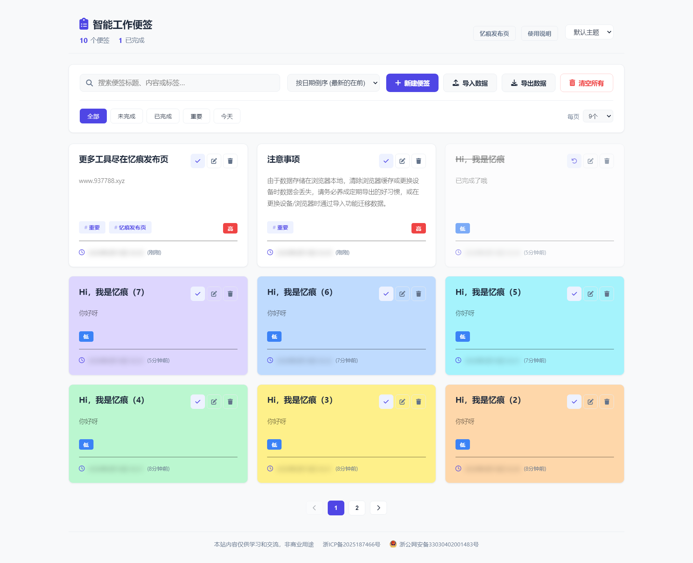

# 智能工作便签

简约风格的在线便签记事工具，纯前端实现，不上传服务器，打开网页即可使用。数据存储在浏览器 `localStorage` 中，支持数据导入导出，方便迁移备份。

演示地址：https://smartnote.937788.xyz/

## 核心功能

#### 便签管理
- 创建、编辑、删除便签，操作流畅直观
- 8 种便签颜色：白、红、橙、黄、绿、青、蓝、紫，用颜色区分内容类型或紧急程度
- 3 级优先级：高 / 中 / 低，优先级高于排序规则，重要事项始终置顶

#### 分类与检索
- 标签分类管理：为便签添加自定义标签，实现多维度归类
- 智能搜索：支持关键词快速检索便签内容
- 灵活过滤：全部 / 未完成 / 已完成 / 重要 / 今天，多种视图一键切换
- 排序功能：按时间、优先级等规则自动排序
- 分页显示：便签数量较多时自动分页，保持界面整洁

#### 数据安全与迁移
- 数据导入导出：支持粘贴文本、拖拽文件、文件选择三种方式，便于备份和跨设备迁移
- 本地存储：所有数据保存在浏览器 `localStorage`，无需联网，隐私安全

#### 个性化与适配
- 4 种主题切换：默认 / 绿色 / 琥珀 / 暗色，满足不同视觉偏好和使用场景
- 响应式布局：完美适配桌面端与手机端，随时随地记录

## 适用场景

-  工作备忘：临时记录会议要点、待办任务、项目进度
-  灵感捕捉：随时记录闪现的想法，避免遗忘
-  清单管理：购物清单、阅读清单、学习计划的快速整理
-  信息中转：跨设备传递短文本，替代临时文件

---

>  提示：由于数据存储在浏览器本地，清除浏览器缓存或更换设备时数据会丢失，请务必养成定期导出的好习惯，或在更换设备/浏览器时通过导入功能迁移数据。

## 截图

